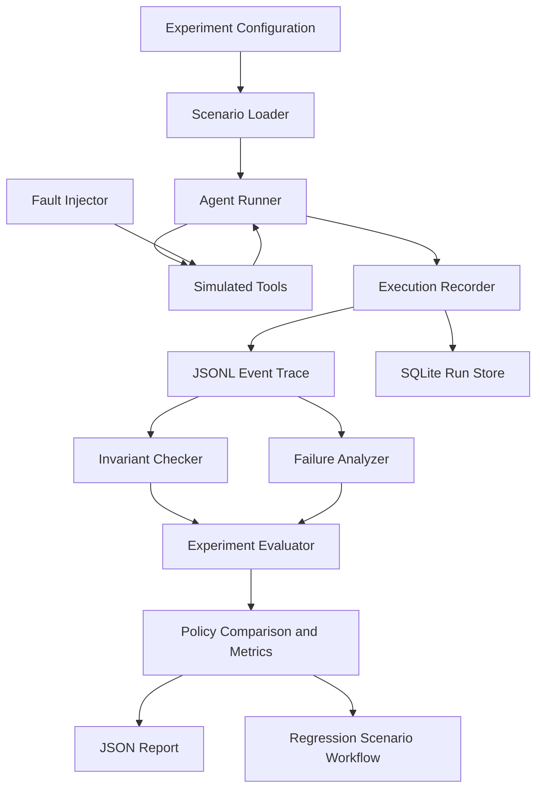

# AgentFault Lab

**Reproduce the failure. Find the broken invariant. Prove the recovery.**

AgentFault Lab is an open-source, local-first laboratory for controlled fault injection and recovery experiments in multi-step agent workflows. It records structured execution events, checks explicit invariants, compares recovery policies, and saves experiment results for inspection and regression testing.

> **Status:** Initial working implementation / research prototype. The benchmark uses a small deterministic simulator. Results are not evidence of production-wide reliability or universal LLM behavior.

## Why this exists

Tracing and LLM evaluation platforms already cover substantial parts of debugging and evaluation. AgentFault Lab focuses on a narrower workflow:

1. Define a workflow and its invariants.
2. Inject a known failure at a controlled point.
3. Record tool calls, results, state transitions, and recovery decisions.
4. Compare no-recovery, retry, and state-aware recovery policies.
5. Export and rerun the scenario as a regression test.

The initial implementation deliberately uses simulated tools and does not require an LLM or a paid API. This makes it possible to validate the test harness before introducing model nondeterminism.

## Features

- Deterministic tool simulator for example workflows.
- Fault injection: timeout, exception, malformed response, and repeated-response marker.
- Structured event traces with sequence numbers and timestamps.
- Explicit invariant checking.
- Three policies: `none`, `retry`, and `state_aware`.
- Experiment runner with repeated trials.
- JSON summary, JSONL run records, per-run trace files, and SQLite persistence.
- FastAPI endpoints and command-line interface.
- Unit, API, integration, regression, and execution-bound tests.
- Dockerfile, Docker Compose, GitHub Actions, and contributor/security documentation.

## Quick start

Requirements: Python 3.10+.

```bash
python -m venv .venv
# Windows PowerShell:
.venv\Scripts\Activate.ps1
# macOS/Linux:
# source .venv/bin/activate

python -m pip install -e ".[dev]"
pytest
```

List scenarios:

```bash
agentfault list --scenarios-dir scenarios
```

Run one scenario:

```bash
agentfault run \
  --scenario order_malformed_response \
  --policy state_aware \
  --scenarios-dir scenarios \
  --output results/one-run.json
```

On Windows Command Prompt, put the command on one line or use `^` for line continuation.

Run the benchmark:

```bash
agentfault benchmark \
  --scenarios order_malformed_response notification_timeout malformed_transform \
  --policies none retry state_aware \
  --trials 5 \
  --scenarios-dir scenarios \
  --output-dir results \
  --experiment-id baseline-v1
```

Or run the supplied configuration from the repository root:

```bash
python benchmarks/run_benchmark.py
```

Outputs include:
- `results/<experiment-id>_summary.json`
- `results/<experiment-id>_runs.jsonl`
- `results/traces/<run-id>.jsonl`
- `results/agentfault.db`

A sample 45-run baseline report and its run records are included in [`results/`](results/README.md).
The observed policy comparison and its interpretation are documented in
[`docs/benchmark-methodology.md`](docs/benchmark-methodology.md).

The SQLite database stores run metadata and event rows. Do not commit generated traces or databases if they contain sensitive data.

## Example scenario

`scenarios/order_processing/order_malformed_response.json` models a state-changing order update that succeeds internally but returns a malformed response. A blind retry can perform the operation twice. The state-aware policy checks the simulated state before retrying.

Run the example:

```bash
python examples/run_one_scenario.py
```

Expected qualitative behavior:
- `none`: stops after the malformed response.
- `retry`: retries the update; the simulated update count becomes 2 and the duplicate-operation invariant is violated.
- `state_aware`: detects the already-applied status update and resumes without applying the update again.

This is a designed simulator scenario, not an empirical claim about arbitrary agent frameworks.

## API

Start the local API from the repository root:

```bash
uvicorn agentfault.api.app:app --host 127.0.0.1 --port 8000
```

Open the interactive API docs at `http://127.0.0.1:8000/docs`.

Endpoints:
- `GET /health`
- `GET /scenarios`
- `POST /runs`
- `POST /experiments`

Example run request:

```json
{
  "scenario_id": "notification_timeout",
  "policy": "retry",
  "seed": 7
}
```

The API reads scenarios from the repository-relative `scenarios/` directory. Start it from the project root or adjust the deployment working directory accordingly. The API is intended for local trusted use; do not expose it publicly without authentication, rate limits, and stronger isolation.

## Docker

```bash
docker compose up --build
```

The API is exposed on port 8000. Results are written to the mounted `results/` directory. This container does not execute arbitrary user-provided agent code; do not add that capability without a dedicated sandbox design.

## Architecture



### Main modules

- `models.py`: validated scenario, event, and result schemas.
- `runner/engine.py`: deterministic workflow runner.
- `faults/injector.py`: call-count-based deterministic faults.
- `invariants/checker.py`: invariant checks.
- `recovery/policies.py`: bounded recovery policy definitions.
- `recorder/recorder.py`: append-only structured event recorder.
- `evaluation/metrics.py`: aggregate metrics and Wilson confidence interval utility.
- `store.py`: SQLite persistence.
- `experiment.py`: repeated experiment orchestration.
- `analysis/report.py`: JSON, JSONL, trace, and database outputs.
- `api/app.py`: FastAPI interface.
- `cli.py`: command-line interface.

## Benchmark methodology

Included scenarios cover:
- A malformed response after a state-changing order update.
- A transient notification timeout.
- A malformed transformation response.

Policies:
- `none`: no retry.
- `retry`: bounded blind retry.
- `state_aware`: inspect known simulated state before retrying an order update.

Metrics currently reported:
- Task success rate.
- Fault injection rate.
- Invariant violation rate.
- Mean tool calls.
- Mean retries.
- Median duration.
- Total invariant violations.

Run the benchmark with multiple trials and retain the configuration with the results. The current scenarios are deterministic, so repeated trials primarily validate repeatability and output handling; they are not independent stochastic samples. Do not interpret a confidence interval from repeated identical deterministic runs as evidence of generalization.

### What is and is not measured

Measured by the current implementation:
- Whether a configured fault was triggered.
- Whether the workflow reached its configured expected final state.
- Whether explicit supported invariants were violated.
- Tool-call and retry counts.
- Runtime of the local simulation.
- Whether a known duplicate-operation scenario is caught.

Not yet established:
- General root-cause diagnosis for arbitrary LLM behavior.
- Reliability across external agent frameworks.
- Production latency or throughput.
- Security of executing arbitrary user code.
- Generalization to real production workloads.
- Superiority over existing observability platforms.

## Scenario format

Scenarios are JSON documents validated with Pydantic. They include a task, initial state, ordered action list, optional fault, invariants, and execution bounds. The simulator currently supports these tools:

- `validate_order`
- `update_order_status`
- `send_notification`
- `read_file`
- `transform_data`
- `mark_complete`

Supported fault kinds:
- `timeout`
- `exception`
- `malformed`
- `repeat_response`

Supported invariant kinds:
- `required_final_state`
- `unique_operation`
- `no_false_completion`
- `no_malformed_result_used`

Add a new tool or invariant only with tests and an updated scenario example.

## Security and privacy

- The project runs simulated tools and does not require credentials.
- The API has no authentication; keep it bound to localhost unless you add security controls.
- Traces may include tool arguments and state snapshots. Avoid secrets and personal data in scenarios.
- Do not execute arbitrary submitted Python code in the API process.
- If you add real tools, use explicit allowlists and safe test environments.

See [`docs/threat-model.md`](docs/threat-model.md).

## Development

```bash
python -m pip install -e ".[dev]"
pytest
```

Optional style check:

```bash
ruff check src tests
```

The project targets Python 3.10+. CI tests Python 3.10, 3.11, and 3.12.

## Roadmap

1. Harden event semantics and scenario schema.
2. Add scenario-level expected-result validation.
3. Add scenario minimization for failing runs.
4. Add optional local LLM adapter, with prompts/model metadata captured.
5. Add bootstrap comparisons for stochastic runs.
6. Add one framework adapter after verifying the core interface.
7. Add a lightweight trace viewer only if users need it.

## Prior art and related work

This project is not a replacement for general tracing or evaluation products. Useful comparison points include:
- [Arize Phoenix](https://github.com/Arize-ai/phoenix)
- [Langfuse](https://github.com/langfuse/langfuse)
- [AgentOps](https://github.com/AgentOps-AI/agentops)
- [DeepEval](https://github.com/confident-ai/deepeval)
- [SWE-bench](https://github.com/SWE-bench/SWE-bench)

The proposed distinction is a small, reproducible workflow connecting injected failures, observable invariant violations, recovery-policy comparison, and regression scenarios. That distinction should be validated against current releases before making originality claims.

## License

MIT. Check third-party dependency and model licenses before redistributing optional components.
